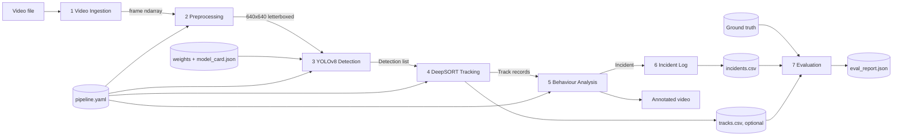
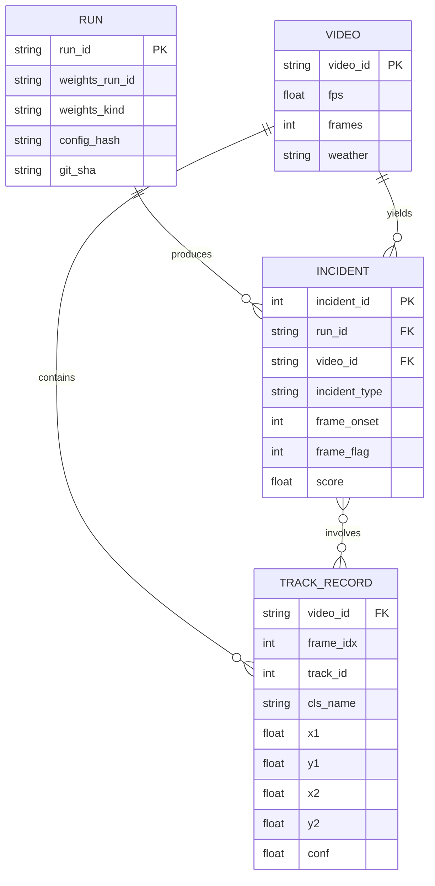
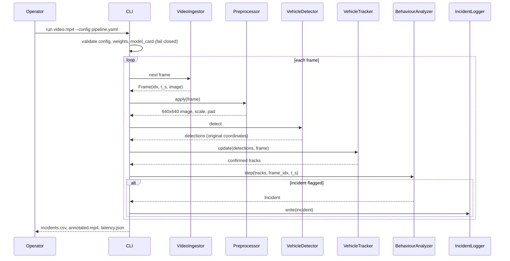
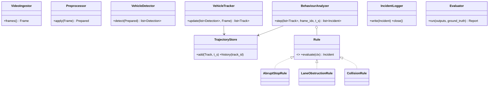

# 02. Architecture, contracts, and behaviour rules

Design source for report section 4 and for the code. All threshold values here are **PROVISIONAL defaults**; they are calibrated on the validation split in Phase 4 and then frozen in `configs/pipeline.yaml`.

## 1. Architecture



## 2. Package layout (target)

```
src/trafficwatch/
  config.py          load and validate pipeline.yaml (fail closed)
  types.py           Frame, Detection, Track, Incident dataclasses (+ to_dict)
  ingestion.py       VideoIngestor
  preprocessing.py   Preprocessor (letterbox 640, optional CLAHE low-light step)
  detection.py       VehicleDetector (loads weights, validates model_card)
  tracking.py        VehicleTracker (DeepSORT wrapper), TrajectoryStore
  behaviour/         rules.py (Rule, AbruptStopRule, LaneObstructionRule, CollisionRule), analyzer.py
  incident_log.py    IncidentLogger (CSV)
  data/              manifest.py (Phase 0), ua_detrac.py, split.py (Phase 1); scripts in scripts/ stay thin CLIs over these
  evaluation/        detector_eval.py, tracker_eval.py, incident_eval.py, latency.py, report.py
  pipeline.py        orchestration, per-stage timers, run manifest
  cli.py             python -m trafficwatch run | eval | calibrate | bench
```

## 3. Module contracts

| Module | Class | Key methods | Notes |
|---|---|---|---|
| Ingestion | `VideoIngestor` | `frames()` yields `Frame(idx, t_s, image)` | Reads fps from the file; optional `frame_stride`; validates file opens |
| Preprocessing | `Preprocessor` | `apply(frame) -> Prepared(image640, scale, pad, original_wh)`; `Prepared.to_original(xyxy)` maps and clips boxes back | Letterbox, aspect preserved; optional CLAHE on L channel for low light; no manual normalisation (D-07) |
| Detection | `VehicleDetector` | `detect(prepared) -> list[Detection]` | Boxes mapped back to original coordinates; drops conf below `detector.conf`; class map from model card |
| Tracking | `VehicleTracker` | `update(detections, frame) -> list[Track]` | `deep-sort-realtime`; only confirmed tracks are emitted; `TrajectoryStore` keeps per-track history |
| Behaviour | `BehaviourAnalyzer` | `step(tracks, frame_idx, t_s) -> list[Incident]`; constructed with `(cfg, period_s)` | Runs the three rules; scene-level context (flow, congestion) computed once per frame |
| Incident log | `IncidentLogger` | `write(incident)`, `close()` | Appends CSV; flushes per incident |
| Evaluation | `evaluation.*` | see doc 05 | Separate from the runtime path |

Data types (dataclasses, `to_dict()` at module boundaries):

| Type | Fields |
|---|---|
| `Frame` | idx, t_s, image (uint8 BGR ndarray) |
| `Detection` | xyxy, conf, cls_id, cls_name |
| `Track` | track_id, xyxy, cls_name, age, hits, confirmed |
| `Incident` | type, track_ids, frame_onset, frame_flag, t_onset_s, t_flag_s, bbox_union, score |

## 4. Configuration (`configs/pipeline.yaml`, validated at startup)

```yaml
run:
  seed: 0
  frame_stride: 1
detector:
  weights: weights/CHANGEME_RUN_ID/best.pt   # or yolov8n.pt in stand-in mode
  weights_kind: trained                      # trained | coco_standin
  imgsz: 640
  conf: 0.35                                 # calibrated in Phase 4
  iou_nms: 0.6
  classes: [car, van, bus, other, two_wheeler]
  standin_class_map: { 2: car, 3: two_wheeler, 5: bus, 7: other }   # COCO ids, coco_standin only
preprocess:
  low_light_enhance: false
  clahe_clip_limit: 2.0        # used only when low_light_enhance is true
  clahe_tile_grid: 8
tracker:
  max_age: 30
  n_init: 3
  max_iou_distance: 0.7
  embedder: mobilenet
behaviour:
  speed_unit: body_heights_per_s
  v_stop: 0.25
  v_move: 1.0
  smoothing_window_s: 0.5
  abrupt_stop: { window_before_s: 1.0, window_after_s: 0.5, drop_ratio: 0.8, max_decel_s: 1.0 }
  lane_obstruction: { min_stationary_s: 15.0, min_flow_fraction: 0.3, rearm_s: 5.0 }
  collision: { v_close: 1.5, iou_min: 0.10, min_frames: 3, post_window_s: 1.5, heading_change_deg: 45 }
  suppression: { queue_gap_bh: 1.5, global_slowdown_fraction: 0.5 }
  zones: { driving_lanes: [], exclusion: [] }   # per-camera polygons in pixels
output:
  dir: reports                # each run writes reports/<run_id>/
  annotated_video: true
  tracks_csv: true
```

Startup validation refuses to run when: weights missing or class names differ from the model card; `weights_kind` is `coco_standin` and the run is flagged as final; any threshold missing or out of range; video unreadable; zone polygons malformed.

## 5. Behaviour rules (the part the specification leaves open)

Common quantities, per confirmed track:

- **Ground point** `g(t)`: bottom-centre of the box. Pairwise geometry uses ground points to reduce false contacts caused by perspective overlap.
- **Body height** `h(t)`: box height, median over the track, used to normalise distance. Speed `v(t)` is measured in **body heights per second**, computed from `g` over the smoothing window and median-filtered. This makes thresholds comparable across image depth and camera scenes.
- **Stationary**: `v <= v_stop`. **Moving**: `v >= v_move`.
- A track needs `age >= n_init` frames before any rule may use it.

### 5.1 Abrupt stop

Flag when, for one track: median speed over `window_before_s` is at least `v_move`, speed over the last `window_after_s` is at most `v_stop`, drop ratio is at least `drop_ratio`, and the deceleration took at most `max_decel_s`.

Suppress (false-alarm control, addresses the specification's own crossing example): a leading track within `queue_gap_bh` body heights ahead is also stopping or stopped (queue); at least `global_slowdown_fraction` of active tracks dropped speed in the same window (congestion, signal); the vehicle is inside an `exclusion` zone (stop line, crossing).

### 5.2 Prolonged lane obstruction

Flag when a track is stationary for at least `min_stationary_s` inside the `driving_lanes` zone, outside `exclusion` zones, **while flow continues**: at least `min_flow_fraction` of other active tracks are moving. If everyone is stopped, it is congestion, not obstruction. Flag once per stationary episode; re-arm after `rearm_s` of motion.

Latency note: onset is when the vehicle became stationary; the flag cannot precede onset plus `min_stationary_s`. Time-to-flag for this rule is reported net of `min_stationary_s` as well as gross.

### 5.3 Collision-like convergence

Flag for a pair (i, j) when all hold: (1) ground-point distance normalised by mean body height is decreasing with closing speed at least `v_close` for at least `min_frames`; (2) box IoU reaches at least `iou_min` at the closest approach; (3) within `post_window_s` after contact, at least one vehicle shows an abrupt speed drop, or a heading change of at least `heading_change_deg`, or both become stationary. If both continue at pre-contact speed and heading, treat as occlusion and do not flag. Dense-traffic overlap is the main false-alarm source here.

### 5.4 Rule engineering constraints

- Rules are pure functions of trajectory history plus scene context, so they are unit-testable with synthetic trajectories (no video, no model).
- Every rule has hand-computed white-box cases: a clean positive, a clean negative, a boundary case at each threshold, and each suppression path.
- Thresholds are never hard-coded; tests pass explicit configs.

### 5.5 Estimator definitions pinned by the white-box tests (decision D-19, PROPOSED)

The rule text above leaves these open. The target tests in `tests/test_rules_*.py` encode them; changing one means changing the tests and logging the decision.

| Item | Definition |
|---|---|
| Speed sample | `v_k = dist(g_k, g_(k-S)) / (smoothing_window_s * h_med)`, `S = smoothing_window_s / dt` samples, `h_med` the median box height over the track history. Undefined for `k < S` |
| Comparisons | Threshold comparisons use a 1e-9 tolerance |
| Abrupt stop | `a` = last sample with `v >= v_move`; pre-speed = median of `v` over the `window_before_s` samples ending at `a`; `b` = first later sample with `v <= v_stop`; deceleration time = `(b - a) * dt`; post-speed = median of `v` over the `window_after_s` samples starting at `b`; flag at the last of those samples |
| Global slowdown | Fraction of active tracks (all tracks with a sample at the current frame) whose own stop pattern is met in the same window |
| Queue | A track within `queue_gap_bh` body heights ahead (ground-point distance, positive projection on the subject's heading) that is stationary or stopping |
| Lane obstruction | Stationary sample is `v <= v_stop`; episode duration is `(k - start) * dt` from the first sample of a run of stationary samples; flag at first `k` reaching `min_stationary_s`; flow fraction is moving (`v >= v_move`) over all other active tracks; empty `driving_lanes` means the whole frame |
| Collision | Pair distance is ground-point distance over mean body height; closing speed is its fall over the smoothing window; contact is the closest-approach sample; heading is the displacement direction over the smoothing window |
| Score | Margin beyond the threshold, clipped to 0..1: abrupt stop `(drop ratio - drop_ratio) / (1 - drop_ratio)`; lane obstruction `(flow fraction - min_flow_fraction) / (1 - min_flow_fraction)`; collision `(peak closing speed - v_close) / v_close` |
| Tracker output | Confirmed tracks matched in the current frame only, with the Kalman-filtered box (`to_ltrb()`); a track that is missed for a frame leaves a gap in its history, which the speed estimator treats as uniformly spaced. Phase 4 calibration on real footage decides whether this needs interpolation |
| Analyzer history | Bounded per track; length derived from the longest configured window (`history_samples`), not a constant |
| Not pinned | Exact 45 versus 44 degree heading boundary, exact `post_window_s` boundary and exact `rearm_s` boundary (fencepost-sensitive): Phase 2 adds unit tests on the helper functions |

## 6. Incident log schema (`incidents.csv`)

| Column | Meaning |
|---|---|
| incident_id | Sequential per run |
| run_id | Run identifier |
| video_id | Source file stem |
| incident_type | ABRUPT_STOP, LANE_OBSTRUCTION, COLLISION_LIKE |
| track_ids | Semicolon-separated |
| frame_onset, frame_flag | Frame indices |
| t_onset_s, t_flag_s | Seconds from video start (frame index over fps) |
| x1, y1, x2, y2 | Union box at flag time |
| score | Margin beyond threshold, clipped to 0..1 |
| rule_params_hash | Hash of the `behaviour` config block |
| weights_run_id, weights_kind | Provenance of the detector |

Optional `tracks.csv`: video_id, frame_idx, t_s, track_id, cls_name, x1, y1, x2, y2 (the tracker does not expose a detection confidence). Used by tracker evaluation and by white-box replay.

## 7. ERD (report section 4 draft)



## 8. Sequence (one detection cycle, report section 4 draft)



## 9. Class diagram (report section 4 draft)



## 10. Run modes

| Command | Purpose |
|---|---|
| `python -m trafficwatch run <video>` | Video to `incidents.csv` and annotated video |
| `python -m trafficwatch eval --split <val or test>` | Five-metric evaluation (test requires `--confirm-final` and writes TEST_ACCESS_LOG) |
| `python -m trafficwatch calibrate` | Grid search of thresholds on val |
| `python -m trafficwatch bench` | Latency benchmark, warm-up excluded |

Optional `--display` shows an OpenCV window for demos. No web UI (scope guard).
